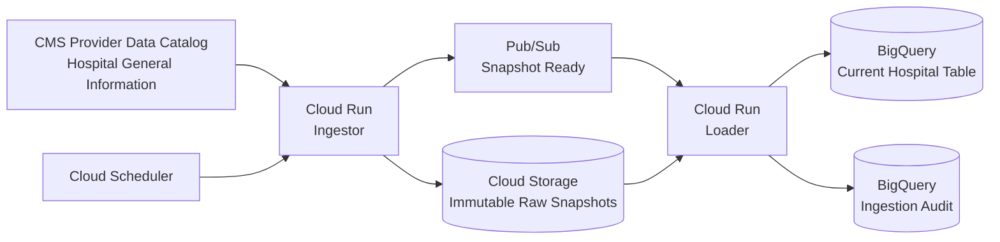

# GCP Healthcare Data Platform

A production-style cloud data platform that ingests real public CMS hospital data into Google Cloud using Cloud Run, Cloud Storage, Pub/Sub, BigQuery, Cloud Scheduler, and Terraform.

> **Portfolio focus:** cloud architecture, event-driven ingestion, immutable raw storage, decoupled processing, auditability, infrastructure as code, CI, and least-privilege service design.

## Architecture



The ingestion service resolves the current CMS CSV resource from the stable dataset identifier rather than hard-coding a transient download URL. Each source snapshot is content-hashed, stored under a timestamped immutable object path, and announced through Pub/Sub. The loader consumes that event, loads the snapshot into BigQuery, and writes an audit record.

## Why this project

The other portfolio projects focus on streaming, lakehouse reliability, and analytics engineering. This project demonstrates the cloud-platform layer around those workloads:

- scheduled ingestion from a public production API/catalog
- Cloud Run microservices
- immutable raw-zone storage
- event-driven decoupling with Pub/Sub
- BigQuery loading and audit metadata
- service-account separation and least-privilege IAM
- Terraform-managed infrastructure
- containerized services
- automated tests and Terraform validation in CI

## Public dataset

This project uses **CMS Hospital General Information** from the CMS Provider Data Catalog. CMS describes the dataset as a list of Medicare-registered hospitals with address, hospital type, ownership, emergency services, and overall hospital rating information.

Dataset identifier: `xubh-q36u`

See [`DATA_SOURCES.md`](DATA_SOURCES.md) for attribution and source details.

## Repository layout

```text
.
├── services/
│   ├── ingestor/           # CMS -> GCS + Pub/Sub Cloud Run service
│   └── loader/             # Pub/Sub -> BigQuery Cloud Run service
├── src/platform/           # shared CMS, hashing, event, and GCP helpers
├── terraform/              # GCP infrastructure as code
├── scripts/                # local utilities
├── tests/                  # deterministic unit tests
├── docs/                   # architecture and design decisions
└── .github/workflows/      # CI
```

## Local setup

```bash
python3 -m venv .venv
source .venv/bin/activate
python -m pip install --upgrade pip
python -m pip install -r requirements-dev.txt
pytest -q
```

The tests do not require GCP credentials and do not call CMS over the network.

### Preview the live CMS metadata resolver

```bash
python -m scripts.resolve_cms_resource
```

This command calls the public CMS metadata API and prints the current CSV resource URL without downloading or uploading anything.

## Service behavior

### Ingestor

`POST /ingest`

1. resolves the current CMS CSV distribution from dataset metadata
2. downloads the CSV to a temporary file
3. computes SHA-256
4. uploads the file to an immutable GCS path
5. publishes a snapshot-ready event to Pub/Sub
6. returns source and object metadata

Object layout:

```text
gs://<raw-bucket>/cms/hospital-general-information/
  ingested_at=2026-10-01T170000Z/
    hospital_general_information.csv
```

### Loader

`POST /pubsub`

1. validates the Pub/Sub push envelope
2. loads the GCS CSV into the current BigQuery hospital table
3. records a row in the ingestion audit table
4. returns load statistics

## Terraform

The Terraform stack provisions:

- required GCP APIs
- versioned Cloud Storage raw bucket
- Pub/Sub topic and push subscription
- BigQuery dataset, current hospital table, and audit table
- Artifact Registry repository
- separate service accounts for ingestor, loader, and scheduler
- Cloud Run services
- Cloud Scheduler job with OIDC authentication
- least-privilege IAM bindings

Start with validation only:

```bash
cd terraform
terraform fmt -check
terraform init -backend=false
terraform validate
```

To plan an actual deployment, copy the example variables:

```bash
cp terraform.tfvars.example terraform.tfvars
# edit project_id and image values
terraform plan
```

**Do not run `terraform apply` until you are comfortable creating billable GCP resources.**

## Container images

Example build commands once Artifact Registry is available:

```bash
gcloud builds submit \
  --config services/ingestor/cloudbuild.yaml \
  --substitutions=_REGION=us-central1,_REPOSITORY=data-platform

gcloud builds submit \
  --config services/loader/cloudbuild.yaml \
  --substitutions=_REGION=us-central1,_REPOSITORY=data-platform
```

## Reliability choices

- **Stable dataset ID**: source discovery is based on CMS metadata, not transient CSV URLs.
- **Immutable raw zone**: each downloaded source snapshot receives a timestamped GCS object path.
- **Content hashing**: SHA-256 accompanies the event and audit record.
- **Decoupled load**: Pub/Sub separates source download from warehouse loading.
- **Current + audit pattern**: BigQuery exposes an easy-to-query current table while GCS retains immutable source history.
- **Independent service accounts**: the ingestor and loader receive different permissions.
- **Retry-friendly endpoints**: services return non-2xx responses when work fails so Cloud Run/Pub/Sub retries remain meaningful.

## Security and privacy

This project uses public CMS provider data only. It does not contain PHI, patient records, employer data, internal schemas, or proprietary code.

## License

MIT. Dataset rights remain with the source publisher; see [`DATA_SOURCES.md`](DATA_SOURCES.md).
